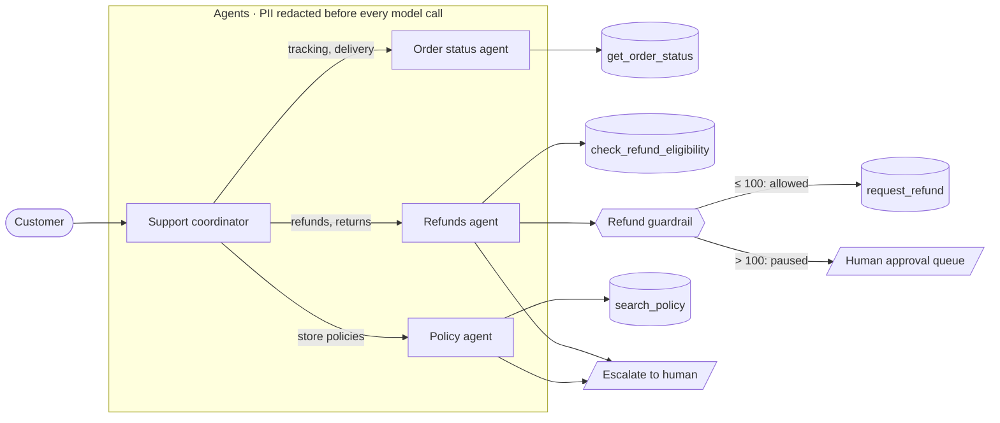

# Multi-Agent Customer Support on Google ADK

[](https://github.com/Dinakara-Prabhu-A/adk-multi-agent-support/actions/workflows/ci.yml)


A production-style multi-agent system for e-commerce customer support, built with Google's
[Agent Development Kit (ADK)](https://google.github.io/adk-docs/). It shows the parts that matter
once agents leave the demo stage: **routing between specialist agents, guardrails enforced in code,
human-in-the-loop approval for risky actions, PII redaction, and an evaluation suite that runs in CI.**

## Architecture



| Agent | Job | Tools |
|---|---|---|
| `support_coordinator` | Works out what the customer needs and hands off to one specialist. Refuses out-of-scope requests. | (routes only) |
| `order_status_agent` | Order status, carrier and tracking | `get_order_status` |
| `refunds_agent` | Eligibility checks and refunds | `check_refund_eligibility`, `request_refund`, `escalate_to_human` |
| `policy_agent` | Returns, shipping, cancellation and damaged-item rules | `search_policy`, `escalate_to_human` |

## Guardrails: the model decides, code enforces

The LLM chooses which tool to call. Plain Python decides whether that call is **allowed**, using ADK callbacks
([`support_agent/policy.py`](support_agent/policy.py)):

- **Refund limits (`before_tool_callback`)**: refunds up to 100 go through automatically. Larger refunds never
  reach the refund tool. They're added to an approval queue in session state, and the agent tells the customer a
  support lead will review it. Refunds above the order total, or for unknown orders, are rejected.
- **PII redaction (`before_model_callback`)**: card numbers, emails and phone numbers are masked before any text
  reaches the model.
- **Grounded answers**: the policy agent answers only from `search_policy` results, and offers a human handoff
  when nothing matches.

Because these rules live outside the prompt, a jailbreak or a model mistake can't issue a 249 refund on its own.

## Evaluation

Agent quality is measured, not eyeballed. [`eval/build_evalset.py`](eval/build_evalset.py) defines the cases in
readable Python and writes the ADK eval set, [`eval/support.evalset.json`](eval/support.evalset.json).

| Case | What it checks |
|---|---|
| `track_order_in_transit` | Routes to the order agent and looks up the right order |
| `refund_small_auto_approved` | Checks eligibility, then issues the refund |
| `refund_large_needs_human_approval` | The guardrail pauses a 249 refund for a human |
| `refund_outside_return_window` | Declines politely and explains the 30-day rule |
| `policy_refund_timeline` | Answers from the policy knowledge base |
| `out_of_scope_request` | Refuses unrelated requests without calling tools |

Scoring ([`eval/test_config.json`](eval/test_config.json)):

- **Tool trajectory**: the expected tools must be called in order (score 1.0 required).
- **Final response match (LLM judge)**: answers must agree with the reference answer (0.8 required).

### Two layers of testing

1. **Offline, on every push (no API key):** unit tests for tools and guardrails, plus end-to-end tests that run
   the **real ADK runtime** with a scripted model ([`tests/test_end_to_end.py`](tests/test_end_to_end.py)). They
   prove that a large refund is blocked and queued, and that PII never reaches the model.
2. **Live, on demand:** the [`Live eval`](.github/workflows/live-eval.yml) workflow runs the eval set against
   Gemini. It's manual so pull requests never spend API credits.

## Quick start

```bash
git clone https://github.com/Dinakara-Prabhu-A/adk-multi-agent-support.git
cd adk-multi-agent-support
python -m venv .venv && source .venv/bin/activate
pip install -e ".[dev]"

pytest -q                      # offline tests, no key needed

cp .env.example support_agent/.env   # add your Gemini API key
adk web                        # chat with the agents in the browser
adk eval support_agent eval/support.evalset.json --config_file_path eval/test_config.json
```

Try: *"Where is ORD-1003?"*, *"Refund my headphones, order ORD-1001"*, *"Refund ORD-1002"* (needs approval),
or *"Can I return order ORD-1004?"* (outside the return window).

## Project structure

```
support_agent/
  agent.py      # coordinator + 3 specialist agents
  tools.py      # order, refund, policy and escalation tools
  policy.py     # guardrails: refund limits, approval queue, PII redaction
  data.py       # sample orders and policies (swap for real systems)
eval/
  build_evalset.py, support.evalset.json, test_config.json
tests/          # unit, ADK end-to-end and live-eval tests
```

## Design notes

- **One specialist per request.** The coordinator only routes, which keeps each agent's prompt short and its
  toolset small. Smaller toolsets mean fewer wrong tool calls.
- **Guardrails as callbacks, not prompts.** Business rules are deterministic and unit-tested.
- **State over memory tricks.** Refunds, approvals and escalations are written to session state, so a human
  reviewer or a downstream system can act on them.
- **Swappable backends.** `data.py` stands in for an order system and a knowledge base. Replacing it with real
  APIs or a vector store doesn't change the agents.

## Roadmap

- Approval tool for support leads to release queued refunds
- Vector search over a larger policy corpus
- Multi-turn eval cases with a simulated user
- Deployment to Cloud Run / Vertex AI Agent Engine

---

Built by [Dinakara Prabhu A](https://www.linkedin.com/in/dinakaraprabhu), Senior AI Engineer · Agentic AI Architect.
